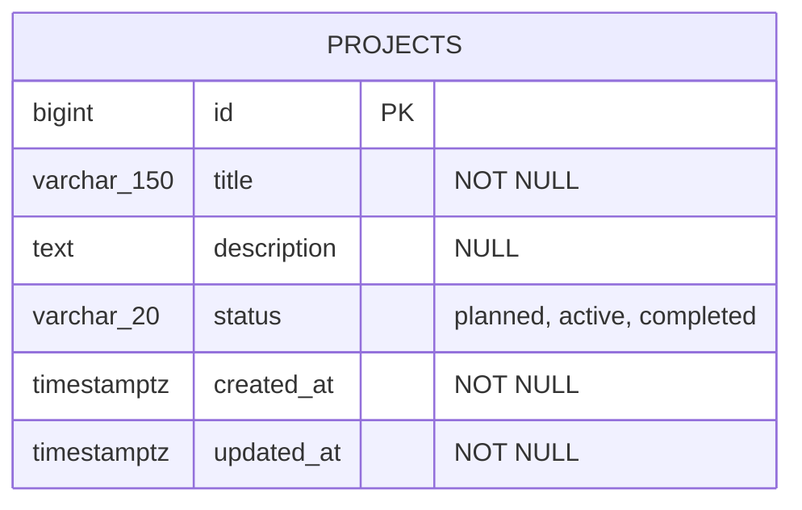

# ProjectHub

**Projekty, zadania i czas pracy w jednym miejscu.**

ProjectHub to aplikacja webowa do organizacji pracy zespołu. Pozwala tworzyć
projekty, opisywać ich zakres i śledzić status realizacji. Panel główny,
lista zadań i widok czasu pracy tworzą wspólną przestrzeń do planowania
codziennych obowiązków.

Projekt rozwijam w ramach zajęć z Wdrażania Projektów i Aplikacji Internetowych.
Backend wykorzystuje PHP 8.3 i architekturę MVC, a dane projektów są zapisywane
w PostgreSQL. Aplikacja ma wspólny układ widoków, jasny i ciemny motyw oraz
responsywny interfejs. Środowisko z Nginx, PHP-FPM i bazą danych uruchamia
Docker Compose.

## Funkcje

Obecny etap projektu obejmuje działającą obsługę projektów oraz interfejsy
kolejnych modułów.

| Obszar | Co robi |
|---|---|
| Panel główny | Widok podsumowania pracy i ogłoszeń z przykładowymi danymi. |
| Projekty | Tworzenie, lista, szczegóły, edycja i usuwanie projektów zapisanych w PostgreSQL. |
| Zadania | Widok sprintu, statusów i terminów z przykładowymi danymi oraz formularz nowego zadania. |
| Czas pracy | Widok przykładowej sesji i historii wpisów. |
| Logowanie i rejestracja | Formularze oraz trasy przygotowane do rozbudowy obsługi kont. |
| API JSON | Pobieranie i wyszukiwanie projektów z bazy oraz przykładowych zadań. |

## Tech stack

| Warstwa | Technologie |
|---|---|
| Backend | PHP 8.3, architektura MVC |
| Widoki | HTML, szablony PHP |
| Baza danych | PostgreSQL 17 |
| Serwer HTTP | Nginx |
| Konteneryzacja | Docker Compose |

## Szybki start

Wymagany jest Git, Docker z Docker Compose oraz lokalny plik `.env` z konfiguracją usług.

```bash
git clone https://github.com/patrykprzybycinski/ProjectHub.git
cd ProjectHub
docker compose up --build -d
```

Przed uruchomieniem kontenerów przygotuj lokalny plik `.env` zgodnie ze zmiennymi używanymi w `docker-compose.yaml`.

Aplikacja: [http://localhost:8080](http://localhost:8080)

## Projekty w PostgreSQL

W lokalnym `.env` ustaw `POSTGRES_DB`, `POSTGRES_USER`, `POSTGRES_PASSWORD`,
`PGADMIN_DEFAULT_EMAIL` i `PGADMIN_DEFAULT_PASSWORD`.
PHP otrzymuje zmienne `POSTGRES_*` z Docker Compose. Połączenie używa hosta
`db` i wewnętrznego portu `5432`. Port `5433` służy klientom na komputerze hosta.

`database/01-create-projects.sql` wykona się automatycznie przy pierwszej
inicjalizacji bazy. Dla istniejącego wolumenu uruchom skrypt jednorazowo
po uruchomieniu kontenerów. W PowerShell użyj poniższego polecenia.

```powershell
Get-Content -Raw -Encoding utf8 database/01-create-projects.sql | docker compose exec -T db sh -c 'psql -v ON_ERROR_STOP=1 -U "$POSTGRES_USER" -d "$POSTGRES_DB"'
```

W Git Bash możesz przekierować plik bezpośrednio.

```bash
docker compose exec -T db sh -c 'psql -v ON_ERROR_STOP=1 -U "$POSTGRES_USER" -d "$POSTGRES_DB"' < database/01-create-projects.sql
```

Skrypt tworzy tabelę i indeksy w jednej transakcji. Kolejne wykonanie dla
istniejącej tabeli zgłosi błąd. Zachowaj aktualne dane logowania istniejącego
wolumenu w `.env`.



Konfigurację odczytuje `config.php`. `src/Database.php` tworzy PDO,
`src/repositories/ProjectRepository.php` wykonuje SQL, a `src/models/Project.php`
reprezentuje rekord. Router korzysta z fabryki kontrolerów zdefiniowanej
w `public/index.php`, która przekazuje gotowe repozytorium.

Formularz `/projects/new` zapisuje nazwę, opis i status. Lista oraz szczegóły
odczytują projekty z bazy. Edycja i usuwanie są dostępne na stronie projektu.
Formularze modyfikujące dane korzystają z tokenu CSRF i przekierowania HTTP 303
po udanym zapisie. Odpowiedź API `GET /api/projects` oraz
`POST /api/projects/search` również korzysta z bazy. Pole JSON `name` zachowuje
nazwę projektu, `statusCode` zawiera kod statusu. `progress` ma wartość `100`
dla ukończonego projektu i `null` dla pozostałych statusów.

### Sprawdzenie laboratorium

1. Uruchom `docker compose up -d --build`.
2. Sprawdź sterownik przez `docker compose exec php php --ri pdo_pgsql`.
3. Sprawdź tabelę poleceniem poniżej.

   ```bash
   docker compose exec db sh -c 'psql -U "$POSTGRES_USER" -d "$POSTGRES_DB" -c "\d projects"'
   ```

4. Dodaj przez formularz trzy projekty ze statusami Planowane, W realizacji
   i Ukończono. Odśwież listę i sprawdź ich obecność.
5. Zmień nazwę i status jednego projektu, sprawdź datę ostatniej zmiany,
   a następnie usuń ten projekt.
6. Sprawdź wymuszenie statusu bezpośrednio w bazie. Polecenie ma zakończyć się
   błędem ograniczenia `projects_status_check`.

   ```bash
   docker compose exec db sh -c 'psql -v ON_ERROR_STOP=1 -U "$POSTGRES_USER" -d "$POSTGRES_DB"'
   ```

   ```sql
   INSERT INTO projects (title, status) VALUES ('Sprawdzenie statusu', 'invalid');
   ```

## Struktura projektu

```text
ProjectHub/
├── database/
│   └── 01-create-projects.sql       # Tabela projects, ograniczenia i indeksy
├── docker/
│   ├── db/
│   │   └── Dockerfile               # Obraz PostgreSQL 17
│   ├── nginx/
│   │   ├── Dockerfile               # Obraz serwera HTTP
│   │   └── nginx.conf               # Obsługa żądań i przekazywanie ich do PHP
│   └── php/
│       └── Dockerfile               # PHP 8.3-FPM i rozszerzenia, w tym pdo_pgsql
├── public/
│   ├── css/
│   │   ├── style.css                # Style wspólne, motywy i formularze kont
│   │   └── workspace.css            # Układ panelu i style modułów aplikacji
│   ├── js/
│   │   └── theme.js                 # Przełączanie i zapamiętywanie motywu
│   ├── views/
│   │   ├── layout.html.php          # Wspólny szablon strony i nawigacja
│   │   ├── home.html.php            # Strona startowa
│   │   ├── dashboard.html.php       # Panel główny
│   │   ├── projects.html.php        # Lista projektów z bazy
│   │   ├── project.html.php         # Szczegóły i akcje projektu
│   │   ├── project-create.html.php  # Formularz tworzenia i edycji projektu
│   │   ├── tasks.html.php           # Lista zadań
│   │   ├── task-create.html.php     # Formularz nowego zadania
│   │   ├── time.html.php            # Sesja i historia czasu pracy
│   │   ├── login.html.php           # Formularz logowania
│   │   ├── register.html.php        # Formularz rejestracji
│   │   ├── not-found.html.php       # Strona błędu 404
│   │   └── server-error.html.php    # Komunikat błędu serwera
│   └── index.php                    # Punkt wejścia, trasy i składanie zależności
├── src/
│   ├── controllers/
│   │   ├── AppController.php        # Wspólne renderowanie widoków
│   │   ├── DefaultController.php    # Strona startowa i strony błędów
│   │   ├── DashboardController.php  # Panel główny i widok czasu pracy
│   │   ├── ProjectController.php    # Obsługa formularzy i CRUD projektów
│   │   ├── TaskController.php       # Lista i formularz zadań
│   │   ├── AuthController.php       # Trasy logowania i rejestracji
│   │   └── WorkspaceApiController.php # Odpowiedzi JSON i wyszukiwanie
│   ├── models/
│   │   └── Project.php              # Dane projektu, typy i walidacja
│   ├── repositories/
│   │   └── ProjectRepository.php    # Zapytania SQL i mapowanie rekordów na modele
│   ├── Database.php                 # Tworzenie połączenia PDO
│   └── WorkspaceData.php            # Przykładowe dane modułu zadań
├── .env                             # Lokalna konfiguracja usług, ignorowana przez Git
├── .gitignore                       # Reguły wykluczania plików
├── config.php                       # Odczyt konfiguracji połączenia ze środowiska
├── docker-compose.yaml              # Usługi, sieć i trwały wolumen PostgreSQL
├── Routing.php                      # Dopasowanie metody HTTP i adresu do kontrolera
└── README.md
```

Żądanie trafia do `public/index.php`, gdzie router wybiera kontroler.
Kontroler projektów korzysta z repozytorium, które wykonuje zapytania przez
PDO i zwraca obiekty `Project`. Widoki otrzymują gotowe dane do wyświetlenia,
a endpointy API udostępniają je w formacie JSON.

## Zasady developmentu

- Osobny branch dla każdej funkcji lub zmiany.
- Małe, logiczne commity.
- Prefiksy commitów: `feat`, `fix`, `docs`, `refactor`, `test`, `chore`.
- Sekrety wyłącznie w lokalnym pliku `.env`, poza repozytorium.

## Autorzy

- **Patryk Przybyciński** — autor projektu, rozwój i utrzymanie repozytorium.
