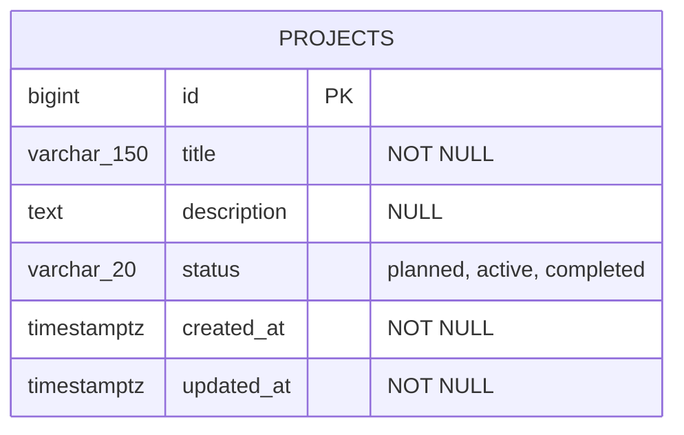

# ProjectHub

ProjectHub pomaga zespołom organizować wspólną pracę, łącząc projekty, zadania i rejestrowanie czasu w jednej aplikacji webowej.

## Funkcje

Projekt jest w trakcie rozwoju. Docelowy zakres obejmuje:

| Obszar | Co robi |
|---|---|
| Panel główny | Prezentuje podsumowanie projektów, zadań i czasu pracy. |
| Projekty | Umożliwia organizację projektów i monitorowanie postępów. |
| Zadania | Pomaga zarządzać obowiązkami, statusami i terminami. |
| Czas pracy | Pozwala rejestrować czas poświęcony na realizację projektów. |

## Tech stack

| Warstwa | Technologie |
|---|---|
| Backend | PHP 8.3, architektura MVC |
| Widoki | HTML, szablony PHP |
| Baza danych | PostgreSQL 17 |
| Serwer HTTP | Nginx |
| Konteneryzacja | Docker Compose |

## Szybki start

Wymagany jest Git, Docker z Docker Compose oraz lokalny plik `.env` z konfiguracją usług.

```bash
git clone https://github.com/patrykprzybycinski/ProjectHub.git
cd ProjectHub
docker compose up --build -d
```

Przed uruchomieniem kontenerów przygotuj lokalny plik `.env` zgodnie ze zmiennymi używanymi w `docker-compose.yaml`.

Aplikacja: [http://localhost:8080](http://localhost:8080)

## Projekty w PostgreSQL

Skopiuj `.env.example` do lokalnego `.env` i ustaw dane dostępu do usług.
PHP otrzymuje zmienne `POSTGRES_*` z Docker Compose. Połączenie używa hosta
`db` i wewnętrznego portu `5432`. Port `5433` służy klientom na komputerze hosta.

`database/01-create-projects.sql` wykona się automatycznie przy pierwszej
inicjalizacji bazy. Dla istniejącego wolumenu uruchom skrypt jednorazowo
po uruchomieniu kontenerów. W PowerShell użyj poniższego polecenia.

```powershell
Get-Content -Raw -Encoding utf8 database/01-create-projects.sql | docker compose exec -T db sh -c 'psql -v ON_ERROR_STOP=1 -U "$POSTGRES_USER" -d "$POSTGRES_DB"'
```

W Git Bash możesz przekierować plik bezpośrednio.

```bash
docker compose exec -T db sh -c 'psql -v ON_ERROR_STOP=1 -U "$POSTGRES_USER" -d "$POSTGRES_DB"' < database/01-create-projects.sql
```

Skrypt tworzy tabelę i indeksy w jednej transakcji. Kolejne wykonanie dla
istniejącej tabeli zgłosi błąd. Zachowaj aktualne dane logowania istniejącego
wolumenu w `.env`.



Konfigurację odczytuje `config.php`. `src/Database.php` tworzy PDO,
`src/repositories/ProjectRepository.php` wykonuje SQL, a `src/models/Project.php`
reprezentuje rekord. Router korzysta z fabryki kontrolerów zdefiniowanej
w `public/index.php`, która przekazuje gotowe repozytorium.

Formularz `/projects/new` zapisuje nazwę, opis i status. Lista oraz szczegóły
odczytują projekty z bazy. Edycja i usuwanie są dostępne na stronie projektu.
Formularze modyfikujące dane korzystają z tokenu CSRF i przekierowania HTTP 303
po udanym zapisie. Odpowiedź API `GET /api/projects` oraz
`POST /api/projects/search` również korzysta z bazy. Pole JSON `name` zachowuje
nazwę projektu, `statusCode` zawiera kod statusu. `progress` ma wartość `100`
dla ukończonego projektu i `null` dla pozostałych statusów.

### Sprawdzenie laboratorium

1. Uruchom `docker compose up -d --build`.
2. Sprawdź sterownik przez `docker compose exec php php --ri pdo_pgsql`.
3. Sprawdź tabelę poleceniem poniżej.

   ```bash
   docker compose exec db sh -c 'psql -U "$POSTGRES_USER" -d "$POSTGRES_DB" -c "\d projects"'
   ```

4. Dodaj przez formularz trzy projekty ze statusami Planowane, W realizacji
   i Ukończono. Odśwież listę i sprawdź ich obecność.
5. Zmień nazwę i status jednego projektu, sprawdź datę ostatniej zmiany,
   a następnie usuń ten projekt.
6. Sprawdź wymuszenie statusu bezpośrednio w bazie. Polecenie ma zakończyć się
   błędem ograniczenia `projects_status_check`.

   ```bash
   docker compose exec db sh -c 'psql -v ON_ERROR_STOP=1 -U "$POSTGRES_USER" -d "$POSTGRES_DB"'
   ```

   ```sql
   INSERT INTO projects (title, status) VALUES ('Sprawdzenie statusu', 'invalid');
   ```

## Struktura projektu

- `docker/` — konfiguracja obrazów i serwera WWW.
- `public/` — punkt wejścia aplikacji i widoki HTML/PHP.
- `src/controllers/` — kontrolery obsługujące żądania.
- `Routing.php` — mechanizm routingu.
- `docker-compose.yaml` — konfiguracja usług środowiska.

## Zasady developmentu

- Osobny branch dla każdej funkcji lub zmiany.
- Małe, logiczne commity.
- Prefiksy commitów: `feat`, `fix`, `docs`, `refactor`, `test`, `chore`.
- Sekrety wyłącznie w lokalnym pliku `.env`, poza repozytorium.

## Autorzy

- **Patryk Przybyciński** — autor projektu, rozwój i utrzymanie repozytorium.
